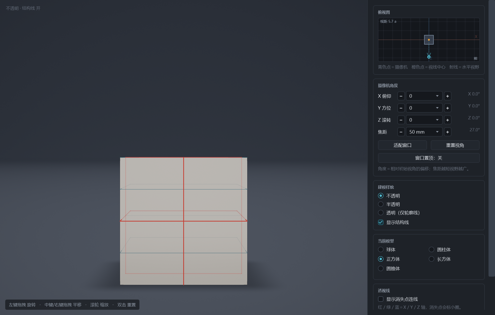

# GeoViewer · 几何参考 / Geometry Reference Viewer

一个给**绘画练习**用的极简 3D 几何体观察工具，Windows + Android 双端，共用一套自研软件渲染器。
A tiny 3D reference tool for **drawing practice** — five standard solids, a real camera model, and
construction lines that behave like an artist's guide lines. Windows and Android share one pure-C#
software renderer.



## 它是什么 / What it is

- 五种标准几何体，**一次只显示一个**，五个共用同一位置与同一尺度，切换时取景不变，方便直接比较体积：
  球体（直径 √2·a）、圆柱体（底面直径 a、高 2a）、正方体（棱长 a）、长方体（底面 a×a、高 2a）、圆锥体（底面直径 a、高 2a）。
  **a = 正方体棱长**，全部底面落在 y = 0。
- 摄像机像建模软件：左键拖拽旋转、中键/右键拖拽平移、滚轮缩放、双击重置。
- **焦距可调**（14–200 mm 等效，约 81°–7° 视角），短焦夸张、长焦接近轴测。
- **透视类型**：自由 / 一点 / 两点 / 三点 / 鱼眼。锁定模式下相机姿态被约束以保持该透视族，
  焦距仍可调（改焦距＝灭点位置整体缩放）；另有独立的「滚动」一行绕视线转动整个画面。
- 三种建模样貌：不透明 / 半透明 / 仅轮廓线；结构线与**红色加粗中线**可开关。
- **透视线**：把棱线延长到当前角度的消失点，X/Y/Z 三轴分色，画面内会标出消失点。
- **练习模式**：每个形体一张角度网格（A 343 / B 147 / C 49 三套方案可切换），
  随机抽一个还没画过的角度→相机自动跳过去→画完打勾；打过勾的不会再被抽到，记录写在本机。
- 右侧栏：俯视图（相机位置 + 视野扇形）、X/Y/Z 角度 + 滚动 + 焦距、透视类型、窗口置顶、练习模式。

## 下载 / Download

| 平台 | 文件 | 说明 |
|---|---|---|
| Windows | `GeoViewer.exe` | 单文件自包含（约 66 MB），双击即用，无需安装 .NET |
| Android | `GeometryViewer-Android.apk` | minSdk 24 / targetSdk 34，约 35 MB |

> Windows 首次运行若被 SmartScreen 拦下：右键 exe → 属性 → 勾选「解除锁定」；或点「更多信息 → 仍要运行」。
> 提示的成因与根治办法（代码签名 / Azure Trusted Signing / 应用商店）见 [SIGNING.md](SIGNING.md)。
> 安卓端目前只有几何体 + 模样 + 角度 + 焦距 + 横屏/收面板，透视类型与练习模式尚未移植。

## 为什么不是 Mesh / Why not a mesh pipeline

五个图元都是解析可求交的凸体，所以渲染器是**逐像素光线投射**（`windows/src/Render/Renderer.cs`）：
没有多边形棱边，轮廓是数学意义上的精确轮廓；z-buffer 也是精确的，因此隐藏线消除、半透明前后混合
都不需要排序技巧。整个程序**零第三方依赖**，只依赖 .NET 与 WPF（Windows）/ Android（手机），
发布产物是单个 exe / 单个 apk。

## 编译 / Build

### Windows

```bat
cd windows
dotnet publish src\GeoViewer.csproj -c Release -r win-x64 --self-contained true ^
  -p:PublishSingleFile=true -p:IncludeNativeLibrariesForSelfExtract=true ^
  -p:EnableCompressionInSingleFile=true -p:DebugType=none -o dist
```

需要 .NET SDK 8.0。也可以直接双击 `windows\编译.cmd`。

### Android

需要 .NET SDK 8.0 + `dotnet workload install android` + JDK 17 + Android SDK。
配置好之后双击 `android\编译.cmd`（脚本里会读取 `ANDROID_SDK_DIR`、`JAVA_HOME` 等环境变量）。
签名与密钥**不在仓库里**：请自备 keystore，或用 debug 签名打包。

## 目录 / Layout

```
windows/
  src/Core/        V3、Camera、Optics（焦距↔视场角）、Lens（透视类型与锁定规则）、
                   Solid（解析求交）、Scene（文档模型）、Practice（练习记录与持久化）
  src/Render/      Renderer（逐像素光栅化）、LineGen（棱线/结构线/中线/透视线）、
                   LineCanvas（线段光栅化 + 深度测试）
  src/UI/          MainWindow、ViewportControl（WPF 视口）、TopViewControl（俯视图）、Theme.xaml
  src/Cli.cs       离屏出图用的命令行
android/
  MainActivity.cs  原生控件界面（不要引入自定义 View 或自定义 [Application] 子类，
                   在 Android 16 上会启动即崩）
  ViewportView.cs  ImageView + 自绘位图
  GeoViewerAndroid.csproj  通过 <Compile Include="..\windows\src\Core\*.cs" /> 复用渲染器
docs/              截图
```

## 命令行 / CLI（离屏出图，便于自动化验证）

```
GeometryViewer.exe --shot out.png --w 1200 --h 800 --ss 2 --solid cube --mode outline \
                   --az -36 --el -3 --lens 2p --mm 85 --struct 1 --persp 1
```

| 参数 | 含义 |
|---|---|
| `--shot <file>` / `--ui <file>` | 离屏渲染一张图 / 连界面一起截图 |
| `--solid sphere\|cylinder\|cube\|cuboid\|cone` | 选模型 |
| `--mode opaque\|translucent\|outline` | 建模样貌 |
| `--az` / `--el` / `--roll` | 相对初始视角的偏移（初始 0/0/0） |
| `--lens free\|1p\|2p\|3p\|fish` | 透视类型 |
| `--sweep` | 画面滚动角（绕视线） |
| `--mm` / `--fov` | 焦距（35mm 等效）或视场角 |
| `--struct 0/1`、`--persp 0/1` | 结构线 / 透视线开关 |
| `--nofit` + `--dist` | 固定相机距离，便于做角度对比 |

## 贡献 / Contributing

欢迎 issue 与 PR。请保持两条约定：

1. **渲染器零第三方依赖**，不要引入 NuGet 包；
2. 改 `Core/Render` 后同时验证 Windows 与 Android 两端（两端共用同一份源码）。

## 许可 / License

MIT，见 [LICENSE](LICENSE)。© 2026 Akoto。

几何体尺寸与结构线规则是通用的绘画教学做法；本仓库不含任何第三方模型、贴图或扫描数据。
